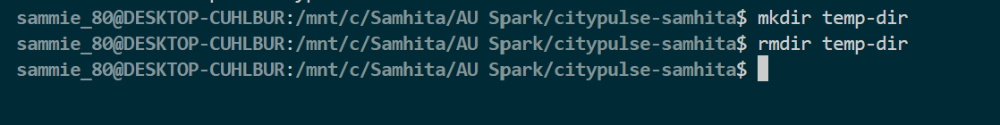
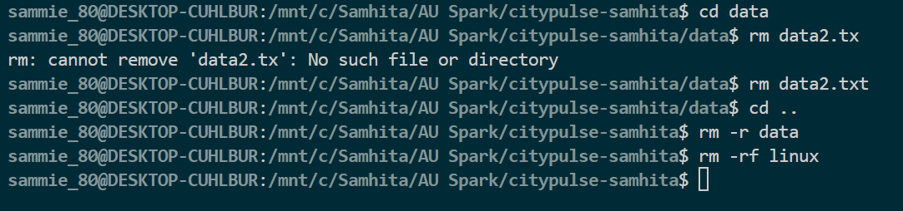
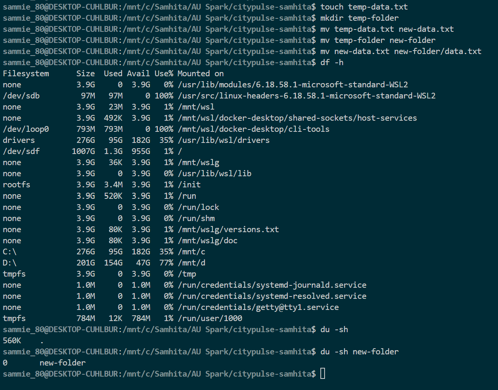
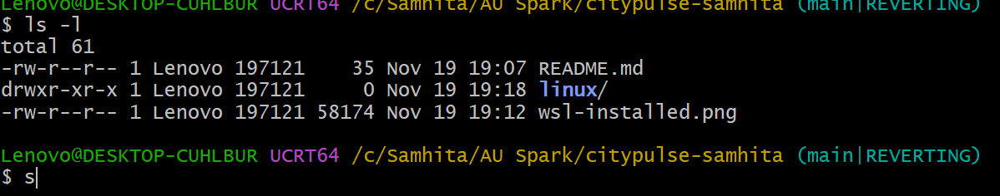
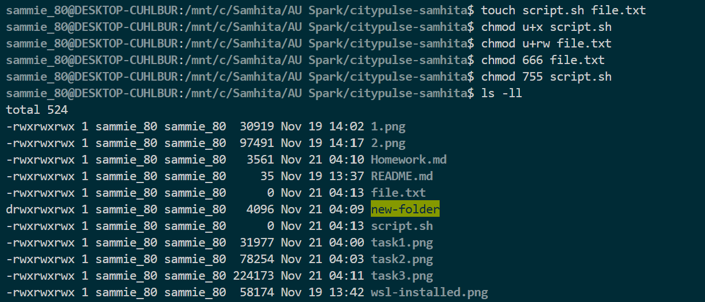
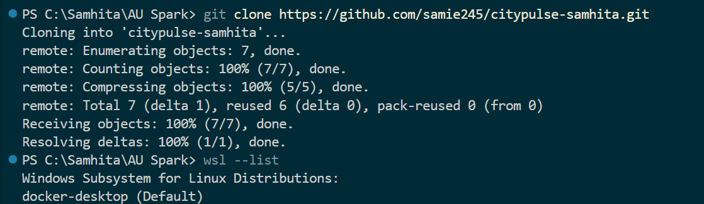

# Atria-CityPulse

## Linux Command-Line Homework Submission

| **Student Name** | Samhita |
|:---|:---|
| **Repository** | Atria-CityPulse |
| **Subject** | Linux Command-Line Operations |

---

## Task 1: Remove Directories

Use `mkdir` to create a directory and `rmdir` to remove an empty directory.

### Commands Performed

```bash
mkdir temp-dir
rmdir temp-dir
```

`rmdir` only works when the directory is empty. Use `rm -r` or `rm -rf` to remove directories that contain files or subdirectories.

### Screenshot Evidence

**Figure 1: Creating and Removing an Empty Directory**



---

## Task 2: Remove Files and Directories Recursively

Use `rm` to remove a file and `rm -r` or `rm -rf` to remove a directory and everything inside it.

### Commands Performed

```bash
# Remove a file
rm filename.txt

# Remove a directory and its contents interactively
rm -r folder-name

# Remove a directory and its contents without prompting
rm -rf folder-name
```

> **Warning:** `rm -rf` permanently deletes data. Double-check the path before running it.

### Screenshot Evidence

**Figure 2: Removing Files and Directories Recursively**



---

## Task 3: Rename Files and Check Disk Usage

### 3.1 Rename a File or Directory

The `mv` command renames a file or directory.

```bash
# Rename a file
mv old-name.txt new-name.txt

# Rename a directory
mv old-folder-name new-folder-name
```

To move and rename a file at the same time:

```bash
mv filename.txt folder/filename.txt
```

### Screenshot Evidence

**Figure 3: Renaming and Moving Files and Directories**



### 3.2 Check Disk Usage

Use `df -h` to see the disk space available on mounted filesystems.

```bash
df -h
```

Use `du -h` to show the size of files and directories.

```bash
# Show the size of the current directory
du -h

# Show only the size of the current directory summary
du -sh

# Show the size of a specific folder
du -sh folder-name
```

### Screenshot Evidence

**Figure 4: Terminal Commands and File Listing**



---

## Task 4: Linux Permissions

Linux files and directories have three permission types:

| Permission | Symbol | Meaning |
|:---|:---:|:---|
| Read | `r` | View file contents or list directory contents |
| Write | `w` | Modify a file or change directory contents |
| Execute | `x` | Run a file as a program or enter a directory |

### Permission Categories

Permissions are assigned to:

- The file owner
- The owner's group
- Other users

### Commands Performed

Use `chmod` to change permissions:

```bash
# Add execute permission for the owner
chmod u+x script.sh

# Give the owner read and write permissions
chmod u+rw file.txt

# Make a file readable and writable by everyone
chmod 666 file.txt

# Give the owner full permissions and others read/execute permissions
chmod 755 script.sh
```

View permissions with:

```bash
ls -l
```

### Common Permission Modes

- `644`: Owner can read/write; group and others can read.
- `755`: Owner can read/write/execute; group and others can read/execute.
- `777`: All users have read, write, and execute permissions.

### Screenshot Evidence

**Figure 5: Enabling and Modifying Linux File Permissions**


---

## Task 5: List Running Processes

Use `ps` to view processes for the current terminal.

```bash
ps
```

Use `ps aux` to list processes from the entire system.

```bash
ps aux
```

To search for a specific process:

```bash
ps aux | grep process-name
```

An alternative, interactive process viewer is:

```bash
top
```

Press `q` to exit `top`.

### Screenshot Evidence

**Figure 6: Listing Running Processes**



### Additional Screenshot Evidence

**Figure 7: Checking WSL Availability**



---

## Screenshot Summary

The following table provides an overview of the screenshots included as evidence for the completed tasks.

| Screenshot | Description |
|:---|:---|
| `task1.png` | Creating and removing a directory |
| `task2.png` | Removing files and directories recursively |
| `task3.png` | Renaming and moving folders |
| `1.png` | Terminal commands and file listing |
| `task4.png` | Enabling and modifying Linux permissions |
| `task5.png` | Listing running processes |
| `wsl-installed.png` | Checking whether WSL is available in the environment |

---

**Submission: Samhita**
**Additonal note: some of the screenshots are from bash as Ubuntu was not installed at that point**